# ABOUT DHEWM3-RT

$\color{red}{\textbf{
This project is not affiliated with Dhewm3.}}$
$\color{red}{\textbf{Do not bother that team with bug reports or feature requests.}}  $

**They have made an understandable stance against AI.**
This project would be impossible without the Dhewm3 foundation and their updates to the original source code making it possible to easily build on modern systems.

|  Dhewm3 |  Dhewm3-RT |
|:---------:|:-----------:|
|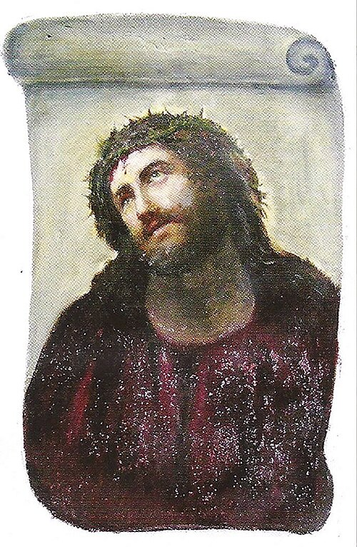|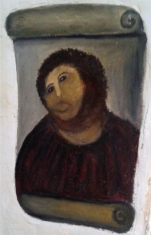|
| Doom3/Dhewm3's source code | Vibe Coded Ray-Traced Additions|

This project has the goal of implementing Ray Tracing in Vulkan on top of Dhewm3 as an experiment in AI development on a complex code-base.  Vulkan allows cross-platform ray-tracing to work on any manufacturer's graphics cards.

_Dhewm 3 RT_ is an updated version of _dhewm 3_ which is based on the _Doom 3_ GPL source port.  I started off a clone of Dhewm3 from the official repository at https://github.com/dhewm/dhewm3 in May 2025 Commit hash: [0277f2](https://github.com/dhewm/dhewm3/commit/0277f298e85d8e2f0ca82a692c6dc0dc0d83c49b).

### Original Dhewm3 and vkDoom3 Source Links
The original Dhewm3 project is hosted at: https://github.com/dhewm

There is an archived _vkDoom3_ Vulkan implementation of Dhewm-BFG edition at  https://github.com/DustinHLand/vkDOOM3, which I found after starting work.

## Overall Impact of RT

Mostly, the ray-tracing is computationally expensive, and tends to fight the original art direction - which the map design and gameplay were already optimized towards.
The various effects here tend to soften the harsh shadows of the original for a more diffuse brighter look.

The two effects that actually add something are the reflections (both specular and glass), and the volumetric lighting.  Those both lean into what I liked about Doom 3: moody atmosphere and the play of light and shadow.

Global illumination was less impressive than I hoped, but specular reflection gives what I'd hoped GI would add.  I could see GI having the biggest improvement to a game like Quake 4 where Doom's harsh shadows look odd in exterior environments.
Shadows and Ambient Occlusion are fairly subtle and look nearly the same for a fair computational cost.

## Process and AI Thoughts

I have been using Claude Code (Sonnet 4.5, Opus) and GitHub Copilot (GPT 5-3 Codex) to develop code.  I mostly review their output, generate plans, and test it quickly, and help debug.  This has mostly worked because:
- Doom3 is a famous C++ code base.
- It uses a well-established language (C++) and frameworks (Vulkan).
- It is a very clean, optimized starting point with no cruft.
- More modern graphics techniques are well known at this point and incorporated into training corpus so the LLMs have good starting points.
- There are good reference implementations to riff on
- This has a quick build cycle, so testing is rapid with quick failure modes that appear in minutes, not months.
- The models have vision modes meaning screenshots can be taken and passed back and forth to help debug issues.
- This is also a solo-dev hobby project - with no need to maintain coherence across multiple developers coding at once.
- I have some experience as a software dev in other domains and can guide the LLM or correct it when hung up.

I would be cautious about assuming any AI coding projects work this well in the real world when most of those conditions are not true or failure modes take longer to appear.

## Testing

Game has been built and tested on two machines in Windows 11 and Linux both running off a SSD.
**Test Machine Specs**
| CPU | GPU |
|------|-----|
| AMD Ryzen 5950X | Nvidia 4070 Ti Super|
| AMD Ryzen 2600 | AMD 9070 XT |
| AMD Ryzen 2600 | Nvidia 2070 Super |

I made no attempts to preserve Dhewm3's Mac builds since the driver situation seems more complicated there and RT did not seem supported in MoltenVK.

# Ray Tracing Changes

## 0. Tweaked lighting on projectiles for some weapons (pulse rifle, rocket launcher)

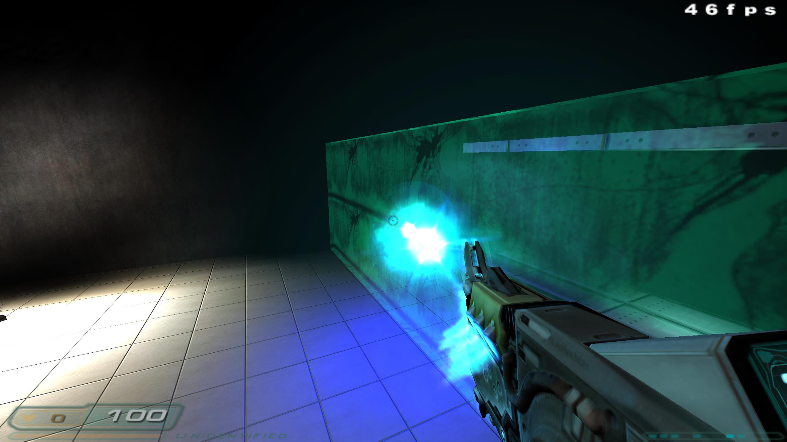
This is just a definition on the weapon to activate an existing effect.  This was already in-game but probably off for 2005 performance reasons.  Most noticeable on plasma and rockets.

The third person shadow was also always there, but never activated.  This is essential for RT reflections reflections, and adds a lot of atmosphere on its own.  See Item 9 for the shadow.

## 1. Vulkan rendering pipeline and acceleration structures.
This kept the original GL pipeline that can be toggled back to, and created a Vulkan pipeline in parallel.  That was the essential starting point for the vendor neutral ray-tracing work.

## 2. Ray Traced shadows.

Top screenshot is RT, lower screenshot is original stencil.  Slight differences in shadows, and we're blurring the shadow edges a little.  In all, it really is not that noticeable.  The third-person player model showing up is more impactful in shadows.

## 3. Ray-Traced Ambient Occlusion with temporal filtering.
Now running properly and leads to darkening in the corners.  This is fairly subtle.
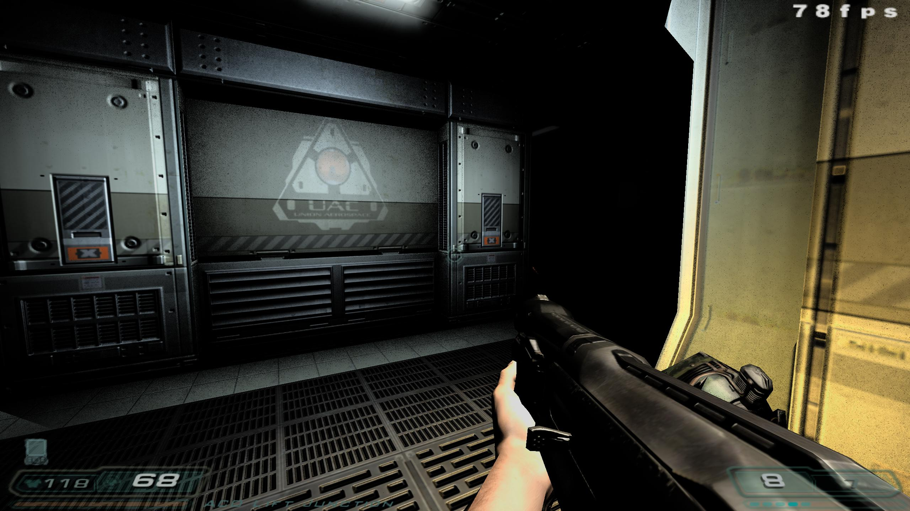
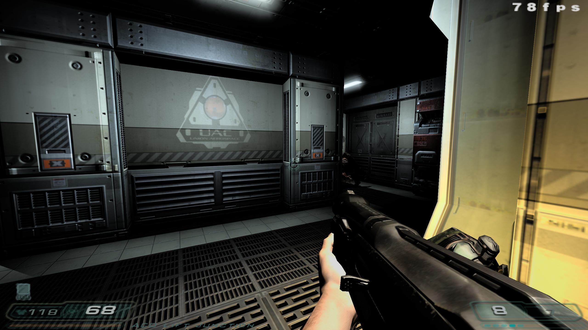

## 4. Ray traced Reflections

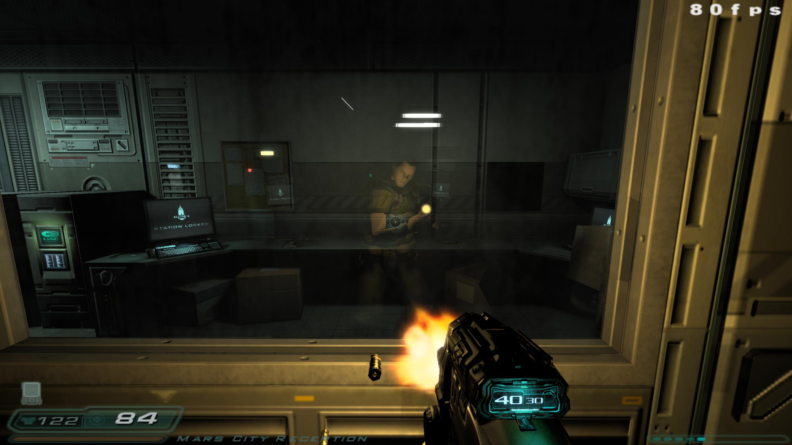
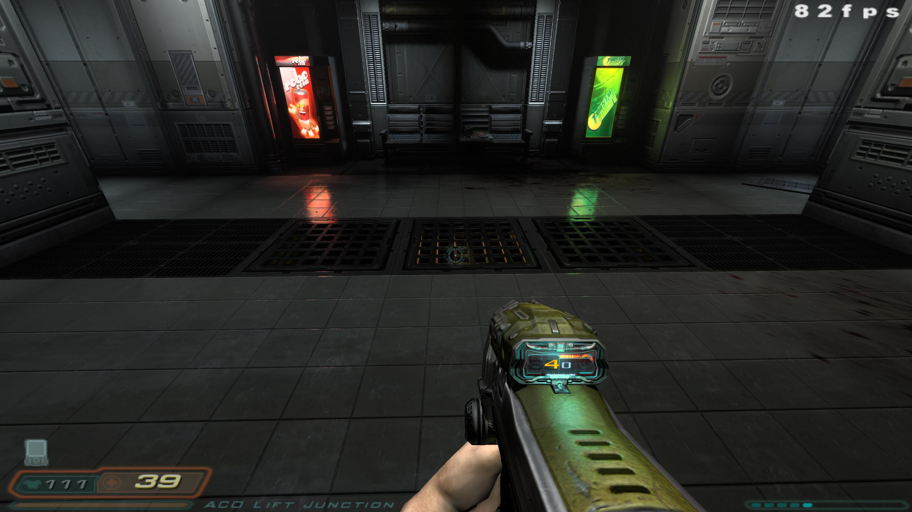
Currently reflections are glass, with GUIs, projectiles, muzzle-flash and specular rough reflections of other surfaces.

With `g_showplayershadow` toggled on, the third person player model is visible and can be reflected.

Animations are not perfectly in sync between third person and first person, but that was already a problem with the existing mirrors.   Animated entities are visible behind you!  This could be fun for horror applications - though comes with a performance cost.  This is perhaps the biggest improvement graphically.

## 5. Global Illumination
This adds one-bounce global illumination.  Reflected surfaces can share luminance (e.g. light bouncing off a red wall illuminates a shadow with red light).  This is potentially most helpful in other games (like Quake4) where the harsh lighting of Doom 3 clashes with the outdoor spaces (pitch black under bridges at midday).

Early attempts allowed GI to pass beyond the light box limits with a flatter fall-off with distance.  This killed the original art direction and led grey lighting everywhere, and never looked good. As it is, the GI is hard to notice in the game.

The global illumination passes were washing out the color and killing the mood.  We have added a Uchimura tone-map to try to restore that dynamic range while sticking close to the original art style even with all the additional luminance.

## 6. Volumetric Lighting
This gives light shafts more substance, with light filling the air.  Lends a lot of mood, especially for moving lights and shadows.  It does soften the harsh lighting of Doom 3, but gives light more volume, so a worthwhile tradeoff.
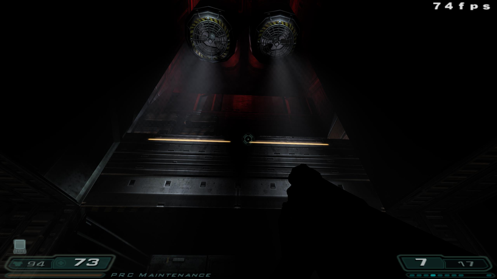
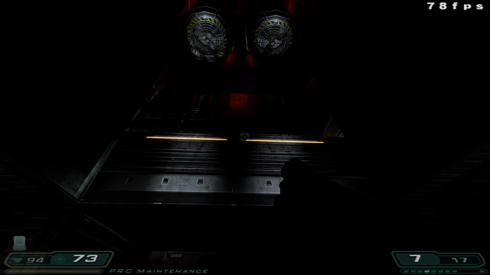

I may have tuned directed volumetrics a bit high (captures the experience of driving at night in 2026):
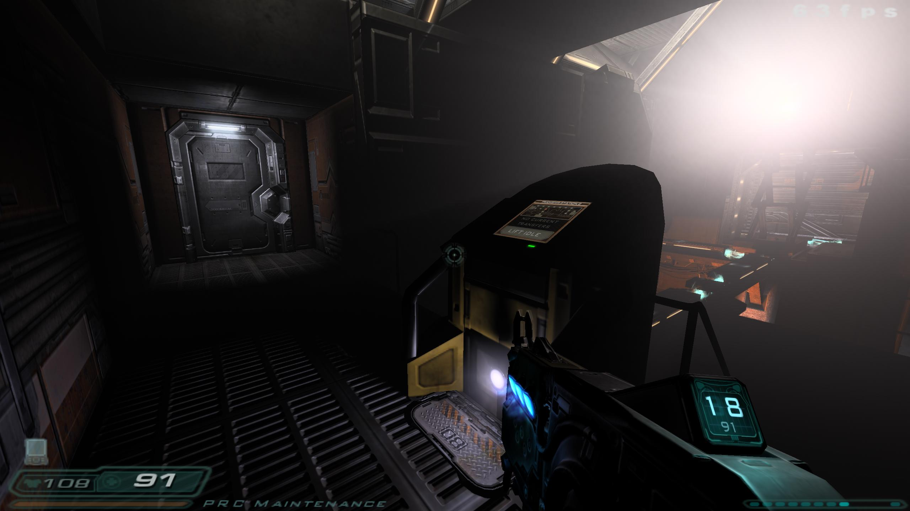

## 7. FSR Upscaling

Added Upscaling to buy back some rendering time from RT effects.  We're just using
AMD Fidelity FX FSR2, with FSR1 as backup, and bilinear upscale as simplest version.
No plans to go to FSR3, since it is harder to build on Linux, and FSR2 looks good enough and works on AMD and Nvidia Hardware.  It mostly looks acceptable, and buys back some performance.  There are some unavoidable tradeoffs between blurriness and aliasing, especially noticeable on grids.

## 8. Controller Update
Tweaked handling of controller with a light auto-aim and added a D-pad weapon selector ala Half-life 2.  Also added rumble for pain, weapon fire, and beast foot steps.  Need to test it works on more controllers.

## 9. First Person Body
Added a custom first person body, based off the marine body, and adjusted in Blender by hand.   The softness comes from the RT shadows. (Note: the third person shadow could appear in the original game)
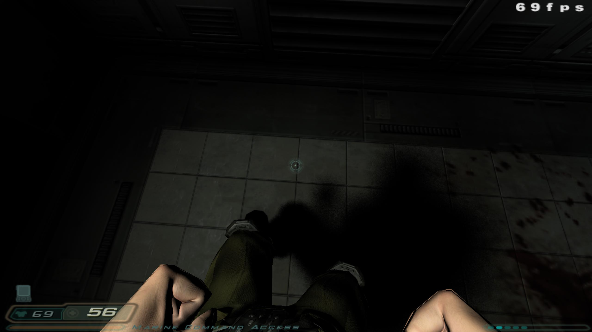

## Defaults Useful Cvars

Right now it defaults to Ray-tracing on, with Vulkan as the engine.

The pipeline and ray-tracing can be enabled/disabled at the terminal in game or via CLI flags.  These are accessible from the Dhewm3 Settings Menu (F10) under Ray Tracing and Upscaling tabs.  The defaults have been set to add noticeable effects - and where a better artist's eye is needed.  Presets and resets have been added.

See `docs/Dhewm3-AI-RT-Settings.md` for a fuller list.

## Additional Files

- Part of the build process requires compiling the Vulkan shaders and copying them.
Currently the compiled shaders are compiled and copied in `base/glprogs/glsl` relative to where the player's save data and config lives.
(e.g. ~/Documents/dhewm3/)

- I am also editing some gun definitions to cast more light.
Those should be copied to `base/def` alongside the shaders to take effect in game.
- Updated Plasma Rifle particles to shed blue light on pulses.
- Updated Rockets to emit light too.

- First person model is in base/models/sp_player.md5mesh and based on the original third person model, though hacked on in Blender so it looks okay from camera perspective.

- There is also a material for tracking added GI accent lights in logging.   Game will break without that material.

- Also a test map ("`simple`") included that I have used for checking shadows/volumetrics/reflections and weapon effects.

# GENERAL BUILD NOTES

Follow the Dhewm3 Notes on patching.  As with Dhewm3, you must have the original game data, purchased from your store of choice.

## Game data and patching

This source release does not contain any game data, the game data is still
covered by the original EULA and must be obeyed as usual.

You must patch the game to the latest version (1.3.1).

Note that the original _Doom 3_ and _Doom 3: Resurrection of Evil_ (together with
_DOOM 3: BFG Edition_, which is *not* supported by dhewm3-rt) are available from the Steam Store at

https://store.steampowered.com/app/208200/DOOM_3/

https://www.gog.com/en/game/doom_3

See https://dhewm3.org/#how-to-install for game data installation instructions.  The same libraries and setup apply with this version.

## Configuration

See [Configuration.md](./Configuration.md) for dhewm3-specific configuration, especially for using gamepads or the new settings menu.

## Compiling

The build system is based on CMake: http://cmake.org/

Required libraries are not part of the tree. These are:

- OpenAL (OpenAL Soft required - need to have the env vars set up)
- SDL v1.2 or 2.0 (2.0 recommended)
- libcurl (optional, required for server downloads)
- Optionally, on non-Windows: libbacktrace (usually linked statically)
  - If this is available, dhewm3 prints more useful backtraces if it crashes
- Vulkan 1.4 (install the SDK) - This is new for Dhewm3-AI_RT.
(The Dhewm3 project provides windows binaries for OpenAL/SDL here: https://github.com/dhewm/dhewm3-libs)

## Back End Rendering of Stencil Shadows

The Doom 3 GPL source code release did not include functionality enabling rendering
of stencil shadows via the "depth fail" method, a functionality commonly known as
"Carmack's Reverse".
It was restored in dhewm3 1.5.1 after Creative Labs' [patent](https://patents.google.com/patent/US6384822B1/en)
finally expired.

## MayaImport

The original Dhewm3 code for the Maya export plugin is still included, if you are a Maya licensee
you can obtain the SDK from Autodesk.

# LICENSES

See COPYING.txt for the GNU GENERAL PUBLIC LICENSE

ADDITIONAL TERMS:  The Doom 3 GPL Source Code is also subject to certain additional terms. You should have received a copy of these additional terms immediately following the terms and conditions of the GNU GPL which accompanied the Doom 3 Source Code.  If not, please request a copy in writing from id Software at id Software LLC, c/o ZeniMax Media Inc., Suite 120, Rockville, Maryland 20850 USA.

See THIRD-PARTY-LICENSES.md for the bundled third-party components (Dear ImGui,
AMD FidelityFX Super Resolution 2, miniz, minizip, stb, and others) — that file
carries the EXCLUDED CODE notice and each component's licence in full.
